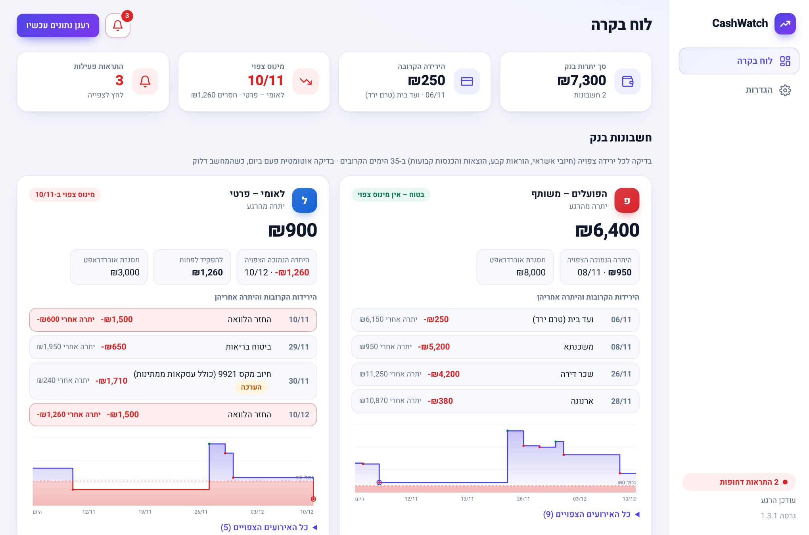
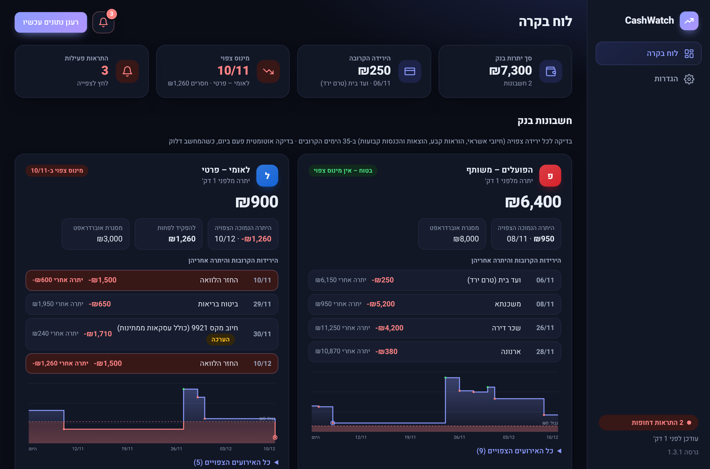
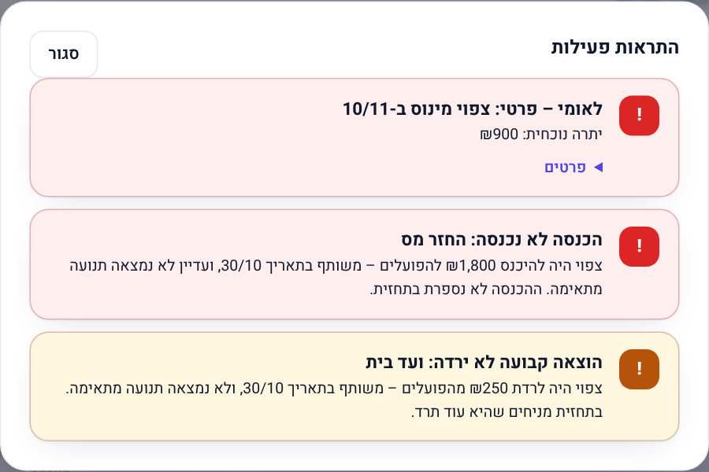
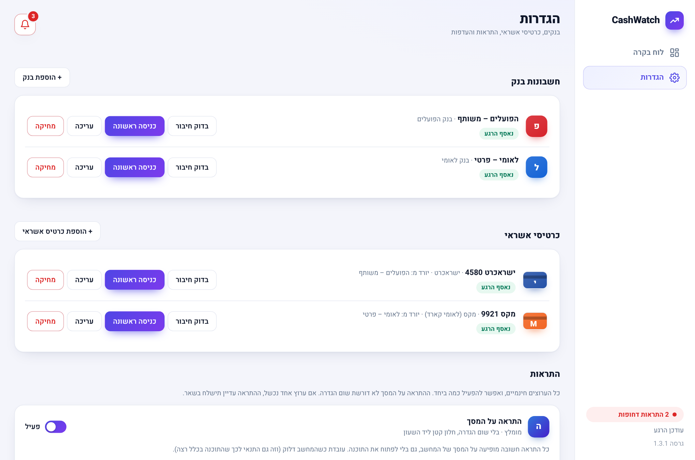
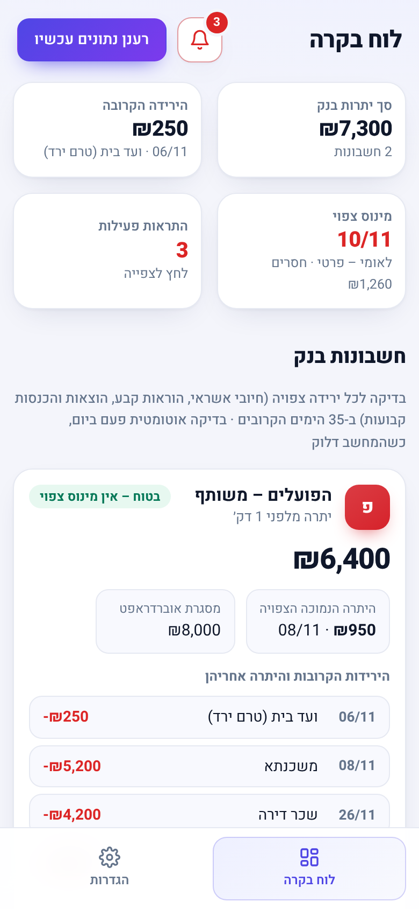
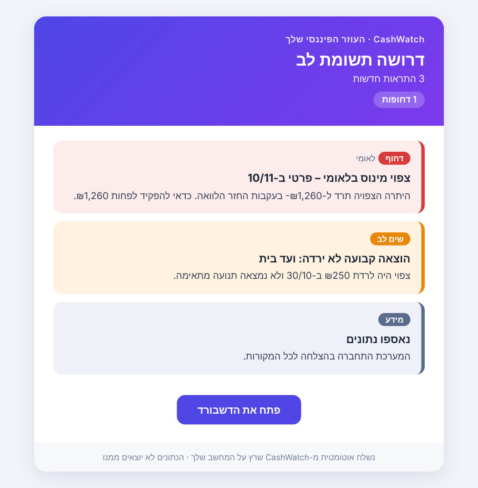
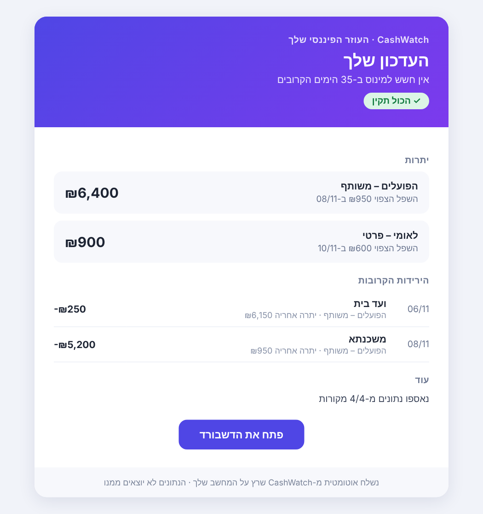
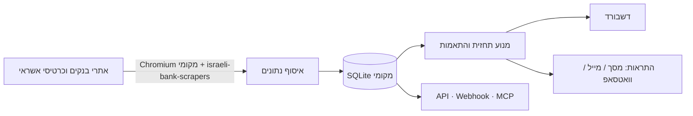

<div align="center">

# CashWatch

**Your local financial watchdog for Israeli banks & credit cards.**

[](LICENSE)


<table><tr>
<td></td>
<td></td>
</tr></table>

</div>

**English summary.** CashWatch runs on your own PC, logs in to your Israeli bank and credit-card sites once a day (via the open-source [`israeli-bank-scrapers`](https://github.com/eshaham/israeli-bank-scrapers)), builds a per-account cash-flow forecast, and alerts you *before* an account goes negative or when an expected income/charge did not arrive. Everything stays on your machine (credentials encrypted), it is free, and it exposes an optional read-only local API, webhooks and an MCP server. The UI is Hebrew/RTL.

---

<div dir="rtl">

## עוזר פיננסי אישי שרץ אצלך על המחשב

**מושך נתונים מהבנקים וכרטיסי האשראי בישראל, מתחזית תזרים לכל חשבון ומתריע לפני שנכנסים למינוס.**

### למה CashWatch

- 📉 **תחזית לכל חשבון בנק בנפרד** – כולל חיובי האשראי שיורדים ממנו, הוראות קבע, והכנסות והוצאות קבועות.
- 🔔 **התראה מוקדמת**: מינוס צפוי, **הכנסה שלא נכנסה** (משכורת), **הוצאה קבועה או חיוב אשראי שלא ירדו**, וכשל באיסוף הנתונים (סיסמה שונתה, חסימה).
- 💳 **התאמת חיובי אשראי** – סכום החיוב הצפוי מול מה שירד בפועל בבנק, לכל כרטיס ולכל חשבון.
- 🔎 **זיהוי אוטומטי של הוצאות והכנסות שחוזרות** מההיסטוריה (חודשי/דו-חודשי/רבעוני), עם אישור או התעלמות. אפשר גם להוסיף הוצאה/הכנסה חד-פעמית.
- 🔒 **הכול נשאר אצלך**: בלי שרת של צד שלישי, פרטי ההתחברות מוצפנים.
- 🆓 **חינמי** – בלי מנוי ובלי שירות בתשלום.

### מה כלול

| רכיב | מה זה |
|---|---|
| **דשבורד** | ממשק בעברית (מצב בהיר/כהה, מובייל): יתרות, תחזית, "הירידות הקרובות", הוראות קבועות, הגדרות והתראות. |
| **התראות** | על המסך (ברירת מחדל, בלי הגדרה), מייל (כתובת + סיסמת אפליקציה), וואטסאפ דרך CallMeBot. |
| **API מקומי** | קריאה בלבד: חשבונות, תנועות, תחזית, התראות. JSON/CSV, מוגן בטוקן. |
| **Webhook ו-MCP** | דחיפת תנועות חדשות החוצה, וחיבור סוכני AI (למשל Claude Desktop) לנתונים המקומיים שלך. |

### צילומי מסך

| | |
|---|---|
|  |  |
| התראות פעילות | הגדרות: בנקים, כרטיסים, התראות |

| מובייל | מייל התראה | מייל עדכון |
|---|---|---|
|  |  |  |

*(צילומי המסך מנתוני הדגמה בדויים.)*

## התקנה

> ⚠️ **קובץ ההתקנה חדש:** הוא נבנה אוטומטית ובדיקות הקוד עברו בשרת הבנייה של GitHub, אבל הוא עדיין לא הותקן ונוסה על מחשבים אמיתיים. אם משהו לא עובד – פתח Issue.

1. הורד את `CashWatch-Setup-<גרסה>.exe` מעמוד ה-[Releases](../../releases). ההתקנה אישית (בלי הרשאות מנהל) וכוללת Node מובנה.
2. נדרש **Microsoft Edge או Google Chrome** מותקן (התוכנה משתמשת בו כדי להיכנס לאתרי הבנקים).
3. הקובץ אינו חתום דיגיטלית, ולכן Windows עשוי להציג "Windows protected your PC": **More info ← Run anyway**.
4. הדשבורד נפתח. בלשונית **הגדרות**: **+ הוספת בנק** ← פרטי כניסה ← ייפתח חלון דפדפן רגיל, התחבר כמו תמיד (גם עם קוד אימות) וסגור אותו. הבנק זוכר את המכשיר ומעכשיו המערכת מתחברת לבד.
5. **+ הוספת כרטיס אשראי** ← בחר מאיזה חשבון בנק יורד החיוב. **התראות** ← "שמור ושלח הודעת בדיקה".
6. זהו. התוכנה עולה עם Windows ובודקת פעם ביום, ברגע שהמחשב דלוק ומחובר (או בשעות קבועות לפי בחירתך).

**חלופות:** הורדת הקוד כ-ZIP והפעלת `CashWatch.bat` (מתקין Node אם חסר), או `npm install` ו-`npm run dev` בשאר המערכות. Docker מתאים לשרת רציף, אך אין בו חלון לכניסה הראשונה.

### בנקים וכרטיסים נתמכים

- **בנקים:** הפועלים, לאומי, מזרחי-טפחות, דיסקונט, מרכנתיל, אוצר החייל, הבינלאומי, מסד, איגוד, יהב, פאגי, One Zero.
- **כרטיסי אשראי:** ישראכרט, אמריקן אקספרס, מקס, כאל, בהצדעה, ביחד בשבילך.

הנתמכים תלויים בספרייה הפתוחה ובאתרי הבנקים, שמשתנים מדי פעם. חלק מהבנקים (למשל הפועלים) דורשים אימות בכניסה ראשונה; One Zero דורש אימות SMS חד-פעמי. לא כל הבנקים נבדקו מול חשבונות אמיתיים.

### עדכונים

התוכנה בודקת פעם ביום (אפשר לכבות) אם פורסמה גרסה חדשה ב-Releases, ומציגה הודעה. בהתקנה מקובץ ההתקנה אפשר לעדכן בלחיצה אחת בהגדרות ← עדכונים: הקובץ מורד ומאומת מול checksum (SHA-256), מותקן בשקט והתוכנה נפתחת מחדש. ההגדרות, הנתונים והסיסמאות נשמרים (הם בתיקיית `data`, שהמתקין לא נוגע בה).

## API, Webhook ו-MCP

למי שרוצה רק את הנתונים (Excel, Home Assistant, סקריפט, סוכן AI) – בלי הדשבורד: בהגדרות ← **API ואינטגרציות** יוצרים טוקן, ומקבלים `http://127.0.0.1:<port>/api/v1/...`. אפשר גם **מצב בלי דשבורד**.

```bash
curl -H "Authorization: Bearer cw_..." "http://127.0.0.1:8080/api/v1/transactions?from=2026-10-01&format=csv"
```

הכול קריאה בלבד ואינו מחזיר סיסמאות. פירוט מלא, Webhook חתום ו-MCP: [`docs/API.md`](docs/API.md).

## אבטחה ופרטיות

- פרטי ההתחברות מוצפנים (AES-256-GCM) במסד נתונים מקומי. ב-Windows המפתח עטוף ב-DPAPI, כלומר קשור למשתמש ה-Windows שלך: העתקת תיקיית הנתונים למחשב אחר לא תאפשר לפענח.
- **נעילה בסיסמה (אופציונלי):** המפתח לא נשמר במחשב בכלל; מזינים סיסמה פעם אחת אחרי כל הפעלת מחשב.
- הדשבורד וה-API נגישים רק מהמחשב עצמו (`127.0.0.1`). הסיסמאות לא חוזרות מה-API/הדשבורד ולא נכנסות ללוגים.
- **מה זה לא מגן מפני:** תוכנה זדונית שרצה תחת המשתמש שלך, או מי שנכנס ל-Windows שלך. תנועות הבנק עצמן (לא הסיסמאות) אינן מוצפנות. מומלץ **BitLocker וסיסמת Windows חזקה**, ושינוי סיסמאות בבנקים אם מחשב אבד.

פירוט ומודל איום: [`docs/SECURITY.md`](docs/SECURITY.md).

## מגבלות ואזהרות משפטיות

- **תנאי שימוש:** איסוף נתונים אוטומטי (scraping) מאתרי בנקים וחברות אשראי עלול להיות מנוגד לתנאי השימוש של חלקם. השימוש באחריותך בלבד.
- **נעילת חשבון:** כניסות חוזרות או סיסמה שגויה עלולות לנעול חשבון. התוכנה מקפידה על רווחים בין כניסות ולא מנסה שוב על סיסמה שגויה, אך אין ערובה.
- **לא ייעוץ פיננסי:** התחזיות הן הערכה שמרנית ועלולות לטעות. אין להסתמך עליהן במקום בדיקה בחשבון עצמו.
- **ללא קשר לבנקים:** הפרויקט אינו קשור, אינו מאושר ואינו נתמך על ידי אף בנק או חברת אשראי. שמות וסמלים שייכים לבעליהם; סמלי הספקים מורדים במחשב שלך מהאתרים הרשמיים ואינם מופצים עם התוכנה.
- התוכנה ניתנת "כמות שהיא" (AS IS), ללא אחריות.
- נדרשת כתובת IP ישראלית (מחשב ביתי); שרתי ענן זרים נחסמים על ידי הבנקים.

## איך זה עובד



התחזית שמרנית: יתרה נבדקת לסוף כל יום; הוצאה שלא ירדה מניחים שתרד מחר; הכנסה שלא נכנסה לא נספרת; עסקאות אשראי ממתינות מוערכות למועד החיוב הקרוב.

## פיתוח

```bash
npm install
npm run demo   # הדגמה עם נתוני דמה, פורט 8099
npm test
```

מדריך מפורט למפתחים בעברית: [`DEVELOPER.md`](DEVELOPER.md). הנחיות לסוכני AI: [`CLAUDE.md`](CLAUDE.md) / [`AGENTS.md`](AGENTS.md).

## תודות ורישיון

- [`israeli-bank-scrapers`](https://github.com/eshaham/israeli-bank-scrapers) מאת Elad Shaham ותורמים נוספים – המנוע שמאפשר את ההתחברות לאתרי הבנקים. פונט [Heebo](https://fonts.google.com/specimen/Heebo).
- רישיון CashWatch: [MIT](LICENSE). רכיבי צד שלישי ברישיונותיהם: [`THIRD_PARTY_NOTICES.md`](THIRD_PARTY_NOTICES.md).

</div>
